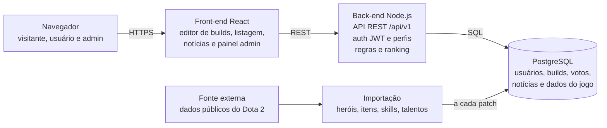

# PRD — Dota Guide: Portal de Builds de Dota 2

24/11/2026

## Visão geral

O Dota Guide é um portal web onde jogadores de Dota 2 criam, publicam e encontram builds de heróis, sempre vinculadas a uma versão (patch) do jogo, e acompanham as principais notícias.

**Problema.** Builds de Dota mudam a cada patch. Guias espalhados em fóruns e vídeos raramente dizem para qual versão foram feitos, e é difícil saber se uma build ainda vale a pena.

**Proposta.** Um editor estruturado de builds (skills por level, grupos de itens, talentos e justificativas), uma listagem com filtro por herói e versão, um ranking feito pela comunidade e uma área de notícias curada pelo admin.

**Objetivos do produto**

- Permitir que qualquer usuário cadastrado monte uma build completa em poucos minutos.
- Deixar claro, em toda build, a versão do Dota a que ela se refere.
- Fazer as melhores builds aparecerem primeiro, por meio de ranking.
- Centralizar as notícias relevantes do Dota 2 no mesmo portal.

## Personas e perfis de acesso

O sistema tem três perfis; só o admin publica notícias.

| Perfil | Quem é | Pode fazer |
| --- | --- | --- |
| Visitante | Jogador sem conta procurando uma build | Ver builds, filtrar, ler notícias e comentários |
| Usuário | Jogador cadastrado que quer compartilhar builds | Tudo do visitante + criar, editar e excluir as próprias builds, votar em builds de outros, comentar em builds |
| Admin | Mantenedor do portal | Tudo do usuário + cadastrar notícias, cadastrar versões do Dota, moderar builds e comentários |

## Escopo do MVP

O MVP entrega o ciclo completo: criar build, encontrar build, votar, comentar e ler notícias.

**Dentro do escopo**

- Cadastro e login de usuários.
- Editor de builds: ordem de skills por level, grupos de itens, árvore de talentos, descrições e versão.
- Página de detalhe da build.
- Listagem de builds com filtros por herói, versão e ranking.
- Sistema de votos para o ranking.
- Comentários em builds.
- Área de notícias com cadastro feito pelo admin.
- Cadastro de versões do Dota pelo admin.

**Fora do escopo (por enquanto)**

- Login via Steam.
- Estatísticas de partidas (win rate real de itens ou heróis).
- Aplicativo mobile nativo.
- Exportar build para o jogo.

## Requisitos: criação de builds

Uma build é composta por herói, versão, sequência de skills, grupos de itens, talentos e textos explicativos.

**RF01 — Dados básicos**

- O usuário escolhe o herói, dá um título à build e opcionalmente informa a posição/função (ex.: carry, mid, suporte).
- A build é obrigatoriamente vinculada a uma versão do Dota (ex.: 7.37d), escolhida de uma lista cadastrada pelo admin.
- A versão atual vem pré-selecionada.

**RF02 — Sequência de skills por level**

- O usuário define qual habilidade evoluir em cada level, do 1 ao 30 (ou até o level que quiser).
- O editor exibe uma grade de levels × habilidades do herói, com clique para marcar.
- O sistema valida as regras do jogo: limite de pontos por habilidade e ultimate apenas nos levels permitidos.
- Cada habilidade pode ter uma descrição opcional explicando sua importância na build.

**RF03 — Grupos de itens**

- O usuário cria quantos grupos quiser, cada um com nome livre (ex.: "Early game", "Mid game", "Situacionais").
- Em cada grupo, adiciona itens buscando pelo nome, e pode reordenar itens e grupos (arrastar e soltar).
- Cada item pode ter uma justificativa opcional.
- Sugestões de nomes de grupo prontas: Starting items, Early game, Mid game, Late game, Situacionais.

**RF04 — Árvore de talentos**

- O editor mostra os 4 níveis de talento do herói (10, 15, 20 e 25), com as duas opções de cada.
- O usuário escolhe uma opção por nível; a escolha é opcional por nível.

**RF05 — Descrição geral**

- Campo de texto livre (com formatação simples, ex.: Markdown) para a estratégia geral da build.

**RF06 — Ciclo de vida**

- A build pode ser salva como rascunho ou publicada.
- O autor pode editar ou excluir a própria build.
- Ao trocar de versão, o autor pode duplicar a build para a nova versão, mantendo o histórico da anterior.
- Builds de versões antigas exibem um aviso de "versão desatualizada".

## Requisitos: listagem, filtros e ranking

A listagem mostra por padrão as builds da versão atual, ordenadas pelo ranking.

**RF07 — Listagem de builds**

- Cada card mostra: herói, título, autor, versão, posição, pontuação e data de atualização.
- Paginação (ou scroll infinito) de 20 builds por página.

**RF08 — Filtros e ordenação**

- Filtro por herói (busca por nome, com ícone).
- Filtro por versão do Dota (padrão: versão atual; opção "todas").
- Filtro por posição/função.
- Ordenação por: mais bem ranqueadas, mais recentes, mais votadas na semana.
- Os filtros ficam na URL, para que a busca possa ser compartilhada.

**RF09 — Ranking**

- Usuários logados votam positivo ou negativo em builds de outros autores (um voto por usuário por build, que pode ser trocado).
- A pontuação da build é o saldo de votos; o ranking pode evoluir depois para um score com peso de tempo.
- O ranking é calculado por versão: votos de uma build valem para a versão à qual ela está vinculada.

**RF10 — Página de herói**

- Cada herói tem uma página com as builds mais bem ranqueadas dele na versão atual.

## Requisitos: comentários em builds

Usuários logados comentam nas builds para tirar dúvidas, sugerir ajustes e discutir a build com o autor.

**RF14 — Comentários**

- Qualquer visitante lê os comentários na página de detalhe da build; só usuários logados comentam.
- Comentário em texto simples, até 2.000 caracteres.
- É possível responder a um comentário, com um nível de resposta (sem árvore infinita).
- Comentários são exibidos dos mais antigos para os mais recentes, com paginação de 20 por página.
- O card da build na listagem mostra a quantidade de comentários.

**RF15 — Edição e moderação**

- O autor do comentário pode editá-lo (exibe a marca "editado") ou excluí-lo.
- O admin pode excluir qualquer comentário.
- Comentário excluído que tem respostas fica como "comentário removido", para manter a conversa legível.
- O autor da build recebe destaque visual nos comentários que ele mesmo fizer.

## Requisitos: notícias

Notícias são criadas apenas pelo admin e ficam numa página pública.

**RF11 — Cadastro de notícias (admin)**

- Campos: título, resumo, imagem de capa, conteúdo (Markdown/rich text), link da fonte opcional, versão relacionada opcional.
- Status: rascunho ou publicada; data de publicação.
- Admin pode editar, despublicar e excluir notícias.

**RF12 — Página de notícias**

- Lista as notícias publicadas, mais recentes primeiro, com destaque para a última.
- Página de detalhe por notícia.
- A home exibe as 3 notícias mais recentes.

**RF13 — Gestão de versões (admin)**

- Admin cadastra versões do Dota (número, data de lançamento, link do patch notes) e marca qual é a atual.

## Requisitos não funcionais

- **Desempenho:** listagem responde em menos de 500 ms com filtros aplicados (índices por herói, versão e pontuação).
- **Segurança:** senhas com hash (bcrypt/argon2), autenticação via JWT, autorização por perfil, validação de entrada no back-end, sanitização de Markdown contra XSS, rate limit em login, votos e comentários.
- **Responsividade:** layout funciona em desktop e celular.
- **SEO:** páginas de builds e notícias com título e descrição próprios e URLs amigáveis.
- **Dados do jogo:** heróis, habilidades, itens e talentos vêm de uma fonte externa (ex.: dados públicos do Dota 2 / OpenDota) importada por script, sem cadastro manual.
- **Qualidade:** testes automatizados no back-end para regras de build e ranking; lint e CI.

## Arquitetura e stack

Dois serviços independentes: um front-end em React que consome uma API REST em Node.js, única camada com acesso ao PostgreSQL.

Um script de importação, rodado a cada patch, carrega heróis, itens, habilidades e talentos no banco.

Cada serviço é um repositório próprio (`dota-guide-api`, `dota-guide-web`), e as specs ficam em `dota-guide-specs`. A stack detalhada de cada projeto fica no `CLAUDE.md` do repositório.

| Camada | Tecnologia |
| --- | --- |
| Front-end | React + TypeScript, Vite, React Router |
| Back-end | Node.js + TypeScript, Fastify, Kysely, TypeBox (contrato OpenAPI gerado do código) |
| Banco | PostgreSQL (Docker em desenvolvimento) |

## Modelo de dados inicial

> Rascunho de referência. O modelo final é decidido no `plan.md` de cada feature, no `dota-guide-api`.

O modelo separa os dados do jogo (importados, por versão) dos dados criados pelos usuários (builds, votos, notícias).

| Tabela | Campos principais | Observação |
| --- | --- | --- |
| users | id, username, email, password_hash, role (user/admin), created_at | role controla acesso ao admin |
| game_versions | id, name (ex.: 7.37d), released_at, patch_notes_url, is_current | só uma com is_current = true |
| heroes | id, name, slug, primary_attribute, image_url | importado |
| abilities | id, hero_id, name, slot, is_ultimate, max_level, image_url | importado |
| talents | id, hero_id, version_id, level (10/15/20/25), side (left/right), description | talentos mudam por versão |
| items | id, name, slug, cost, image_url | importado |
| builds | id, user_id, hero_id, version_id, title, role, description, status (draft/published), score, created_at, updated_at | score = saldo de votos (desnormalizado) |
| build_skill_steps | id, build_id, level (1–30), ability_id | uma linha por level |
| build_ability_notes | id, build_id, ability_id, note | importância de cada skill |
| build_item_groups | id, build_id, name, position | ex.: Early game |
| build_group_items | id, group_id, item_id, position, note | justificativa opcional do item |
| build_talents | id, build_id, talent_id | um por nível de talento |
| build_votes | user_id, build_id, value (+1/−1), created_at | PK composta (user_id, build_id) |
| build_comments | id, build_id, user_id, parent_id (nulo), content, created_at, updated_at, deleted_at | parent_id aponta para o comentário respondido; exclusão lógica |
| news | id, author_id, title, slug, summary, content, cover_url, source_url, version_id, status, published_at | só admin escreve |

Índices principais: builds (hero_id, version_id, score), builds (status, updated_at), build_comments (build_id, created_at), news (status, published_at).

## API: principais endpoints

> Rascunho de referência. O contrato final é proposto no `plan.md` de cada feature, no `dota-guide-api`.

API REST em JSON, prefixo /api/v1; rotas marcadas como "usuário" exigem JWT e "admin" exigem role admin.

| Método | Rota | Acesso | Descrição |
| --- | --- | --- | --- |
| POST | /auth/register | público | Cria conta |
| POST | /auth/login | público | Retorna token JWT |
| GET | /auth/me | usuário | Dados do usuário logado |
| GET | /heroes | público | Lista heróis |
| GET | /heroes/:id | público | Herói com habilidades e talentos (por ?version=) |
| GET | /items | público | Lista itens |
| GET | /versions | público | Lista versões do Dota |
| POST | /versions | admin | Cadastra versão / marca a atual |
| GET | /builds | público | Lista com ?hero=&version=&role=&sort=&page= |
| GET | /builds/:id | público | Build completa |
| POST | /builds | usuário | Cria build |
| PUT | /builds/:id | autor | Atualiza build |
| DELETE | /builds/:id | autor ou admin | Exclui build |
| POST | /builds/:id/duplicate | autor | Copia build para outra versão |
| PUT | /builds/:id/vote | usuário | Registra ou troca voto (+1/−1) |
| DELETE | /builds/:id/vote | usuário | Remove voto |
| GET | /builds/:id/comments | público | Lista comentários (?page=) |
| POST | /builds/:id/comments | usuário | Cria comentário ou resposta (parentId opcional) |
| PUT | /comments/:id | autor do comentário | Edita comentário |
| DELETE | /comments/:id | autor do comentário ou admin | Exclui comentário |
| GET | /news | público | Lista notícias publicadas |
| GET | /news/:slug | público | Detalhe da notícia |
| POST / PUT / DELETE | /news, /news/:id | admin | Gestão de notícias |

## Métricas, roadmap e questões em aberto

**Métricas de sucesso**

- Número de builds publicadas por semana.
- Percentual de builds na versão atual.
- Usuários ativos que votam, comentam ou publicam por mês.
- Média de comentários por build publicada.
- Visitas à listagem que terminam abrindo uma build.

**Roadmap sugerido**

1. Fundação: setup dos repositórios, banco, autenticação, importação de heróis/itens/habilidades/talentos.
2. Builds: editor completo (skills, grupos de itens, talentos, descrições) e página de detalhe.
3. Descoberta e comunidade: listagem com filtros, votos e ranking, comentários, página de herói.
4. Notícias e admin: painel admin para notícias e versões, home com destaques.
5. Lançamento: SEO, ajustes de desempenho, deploy.

**Questões em aberto**

- Qual fonte de dados do jogo usar para heróis, itens e talentos, e como atualizar a cada patch?
- Login via Steam entra no MVP ou depois?
- O ranking deve dar mais peso a votos recentes?
- Builds de versões antigas continuam aparecendo na listagem com o filtro "todas" ou só na página do autor?
- O portal será só em português ou multilíngue?
